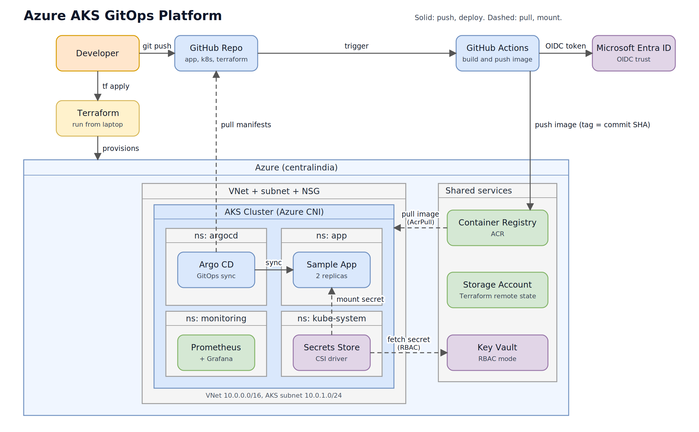
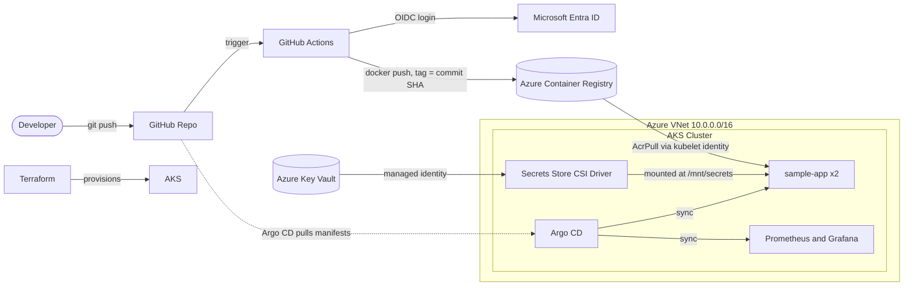
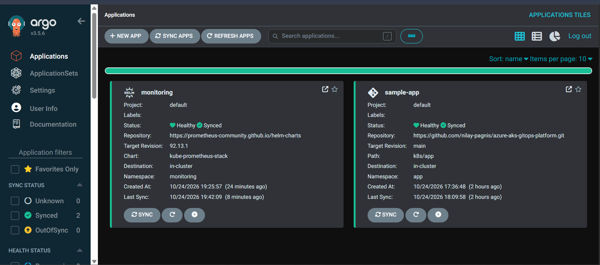
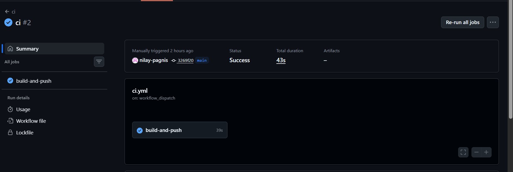

<div align="center">

# Azure AKS GitOps Platform

**A production-style Kubernetes platform on Azure, built end to end with Terraform, GitHub Actions and Argo CD.**

[](https://github.com/nilay-pagnis/azure-aks-gitops-platform/actions/workflows/ci.yml)




</div>

---

## Overview

Push code to GitHub, and the platform does the rest: the image is built and pushed to Azure Container Registry, Argo CD notices the Git change and syncs it to AKS, secrets come from Azure Key Vault, and Prometheus and Grafana show how it is running.

No passwords are stored anywhere in the repo or in the pipeline.

## Highlights

| Area | What is implemented |
|---|---|
| **Infrastructure as Code** | Terraform with remote state in Azure Storage (state locking), VNet, subnet, NSG, AKS, ACR, Key Vault |
| **Networking** | Azure CNI, non-overlapping CIDR plan (VNet vs Kubernetes service range) |
| **CI** | GitHub Actions builds and pushes the image to ACR, tagged with the commit SHA |
| **Passwordless auth** | GitHub to Azure through OIDC federated credentials, AKS to ACR through the `AcrPull` role |
| **GitOps CD** | Argo CD with auto-sync, prune and self-heal (pull-based deployment) |
| **Secrets** | Key Vault in RBAC mode, mounted into pods with the Secrets Store CSI driver and managed identity |
| **Observability** | kube-prometheus-stack (Prometheus, Grafana, kube-state-metrics, node-exporter) deployed through Argo CD |

## Architecture



### Delivery flow

1. A developer pushes code to `main`.
2. GitHub Actions logs in to Azure with OIDC (no stored password) and pushes the image to ACR.
3. The image tag in `k8s/app/deployment.yaml` is committed to Git.
4. Argo CD detects the change and syncs it to AKS.
5. AKS pulls the image from ACR through its managed identity.
6. The pod mounts secrets from Key Vault through the CSI driver.
7. Prometheus scrapes the cluster and Grafana visualises it.

## Network plan

| Range | Use |
|---|---|
| `10.0.0.0/16` | Virtual network |
| `10.0.1.0/24` | AKS subnet (pods get real VNet IPs with Azure CNI) |
| `10.1.0.0/16` | Kubernetes service CIDR, kept separate from the VNet to avoid routing conflicts |

## Repository structure

```
.
├── .github/workflows/
│   └── ci.yml                          # build and push image to ACR (OIDC)
├── app/                                # sample Node.js app and Dockerfile
├── k8s/
│   ├── app/
│   │   ├── deployment.yaml             # app, probes, resource limits, CSI volume
│   │   ├── service.yaml
│   │   └── secretproviderclass.yaml    # Key Vault to pod mapping
│   └── argocd/
│       ├── application.yaml            # sample-app Application
│       └── monitoring-application.yaml# kube-prometheus-stack Application
├── terraform/envs/dev/                 # VNet, NSG, AKS, ACR, Key Vault, roles
└── docs/                               # diagram and screenshots
```

## Screenshots

| Argo CD (apps synced and healthy) | GitHub Actions (CI green) |
|---|---|
|  |  |

| Secret from Key Vault inside the pod | Grafana (namespace `app`) |
|---|---|
|  |  |

## Getting started

### Prerequisites

Azure CLI, Terraform (1.5 or newer), kubectl, Helm, Git, an Azure subscription and a GitHub account.

### 1. Remote state storage

```bash
az login
az group create -n rg-tfstate -l centralindia

export SA_NAME=tfstate<yourname>$RANDOM
az storage account create -n $SA_NAME -g rg-tfstate -l centralindia \
  --sku Standard_LRS --min-tls-version TLS1_2 --allow-blob-public-access false
az storage container create -n tfstate --account-name $SA_NAME --auth-mode key
```

### 2. Configure and deploy infrastructure

In `terraform/envs/dev`:

- `backend.hcl` : set `storage_account_name` to your `$SA_NAME`
- `terraform.tfvars` (not committed) :

```hcl
subscription_id = "<your-subscription-id>"
node_vm_size    = "Standard_D2as_v5"   # pick a size allowed in your region and quota
```

```bash
cd terraform/envs/dev
terraform init -backend-config=backend.hcl
terraform plan
terraform apply
```

### 3. Connect to the cluster

```bash
az aks get-credentials -g rg-aksplat-dev -n aks-aksplat-dev
kubectl get nodes
```

### 4. Configure CI (OIDC)

Create an Entra app registration with a federated credential for your repo and branch, grant it `AcrPush` on the registry, then add these GitHub secrets:

`AZURE_CLIENT_ID`, `AZURE_TENANT_ID`, `AZURE_SUBSCRIPTION_ID`

Update `ACR_NAME` in `.github/workflows/ci.yml` and the image name in `k8s/app/deployment.yaml` with your registry from `terraform output`.

### 5. Add the demo secret (never through Terraform or Git)

```bash
az keyvault secret set \
  --vault-name $(terraform output -raw key_vault_name) \
  --name demo-secret --value "<any-dummy-value>"
```

Put the `terraform output` values (`key_vault_name`, `csi_client_id`, `tenant_id`) into `k8s/app/secretproviderclass.yaml`.

### 6. Install Argo CD and deploy everything

```bash
kubectl create namespace argocd
kubectl apply -n argocd --server-side --force-conflicts \
  -f https://raw.githubusercontent.com/argoproj/argo-cd/stable/manifests/install.yaml

kubectl apply -f k8s/argocd/application.yaml
kubectl apply -f k8s/argocd/monitoring-application.yaml
```

### 7. Open the UIs

```bash
# Argo CD  -> https://localhost:8080  (user: admin)
kubectl -n argocd get secret argocd-initial-admin-secret -o jsonpath="{.data.password}" | base64 -d
kubectl port-forward svc/argocd-server -n argocd 8080:443

# Grafana  -> http://localhost:3000   (user: admin)
kubectl get secret monitoring-grafana -n monitoring -o jsonpath="{.data.admin-password}" | base64 -d
kubectl port-forward svc/monitoring-grafana -n monitoring 3000:80
```

## Try the GitOps behaviour

- **Git is the source of truth:** change `replicas` in `k8s/app/deployment.yaml`, push, and Argo CD scales the app by itself.
- **Self-heal:** run `kubectl scale deployment sample-app -n app --replicas=1` and Argo CD restores the value from Git.
- **Secrets without passwords:** `kubectl exec -n app deploy/sample-app -- cat /mnt/secrets/demo-secret`

## Problems I solved

| Problem | Cause | Fix |
|---|---|---|
| `az login` failed on Windows | WAM broker bug in Azure CLI | Disabled the broker with `az config set core.enable_broker_on_windows=false` |
| Terraform could not find the storage account | Backend name was missing the random suffix | Looked up the real name with `az storage account list` |
| `VM size not allowed` | Size not available for the subscription | Listed allowed SKUs with `az vm list-skus` and switched size |
| `AllocationFailed` | Azure had no capacity for that size in the region | Changed VM size, deleted the half-created cluster, re-applied |
| `resource already exists` on re-apply | Failed cluster was in Azure but not in Terraform state | Deleted it with `az aks delete`, then applied again |
| OIDC login failed (`AADSTS700213`) | GitHub sent an ID-based subject, not the name-based one | Created the federated credential with the exact subject from the error |
| Files created in the wrong folder | Folder name clash while moving (`k8s/k8s`) | Flattened the directory and committed from the repo root |
| Pods Pending: `Too many pods` | Azure CNI default of 30 pods per node was full (Argo CD, CSI, monitoring) | Scaled the node pool to 2 |
| Grafana port-forward dropped | Pod restarted and the forward pointed at the old pod | Waited for the new pod and re-ran the port-forward |

## Security notes

- No passwords or client secrets in Git, GitHub or Terraform state.
- GitHub to Azure uses short-lived OIDC tokens, scoped to `AcrPush` only (least privilege).
- AKS pulls images with `AcrPull` through its kubelet managed identity; ACR admin user is disabled.
- Key Vault uses Azure RBAC: Terraform operator gets `Secrets Officer`, the cluster gets `Secrets User` (read only).
- Images are tagged with the commit SHA, never `latest`.
- `terraform.tfvars` and `.terraform/` are git-ignored; `.terraform.lock.hcl` is committed to pin provider versions.

## Cost and cleanup

This project runs 2 AKS nodes, so do not leave it running. Destroy everything when you are done:

```bash
cd terraform/envs/dev
terraform destroy
```

The remote state resource group (`rg-tfstate`) is kept separately. Key Vault is soft-deleted for 7 days, so purge it if you need to reuse the same name.

## Roadmap

- [ ] Ingress controller with TLS
- [ ] `terraform plan` on pull requests
- [ ] Alertmanager rules and alerts
- [ ] Reusable Terraform modules
- [ ] Auto-update of the image tag in Git after CI (full closed loop)

## What I learned

Capacity is not the same as quota, Azure CNI uses VNet IPs so pod limits matter, and GitOps changes how you think about deployment: Git is the only door into the cluster.

---

<div align="center">

Built by [Nilay Pagnis](https://github.com/nilay-pagnis)

</div>
